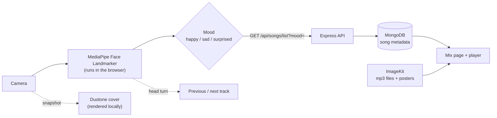

# Moodify

**Look at the camera. Get a playlist that matches your face.**

Moodify reads your facial expression in the browser, works out your mood, and builds a "mood mix" from the songs tagged with it: a Spotify-style playlist page whose cover is your own face. You can even skip tracks by turning your head.

**Live demo:** 

<!--
  Add screenshots here once you have them, e.g.:

  | Detect | Your mix |
  | --- | --- |
  |  |  |
-->

## Features

- **Face → mood, in the browser.** MediaPipe's Face Landmarker turns the camera feed into facial blendshape scores, which are mapped to `happy`, `sad`, `surprised` or `neutral`.
- **Mood mix page.** A playlist page (big cover, title, numbered tracklist) built from the songs tagged with your mood.
- **Your face as the cover.** The camera frame becomes a duotone cover in the mood's colours. "Save cover" downloads it as a 1080×1080 PNG, rendered locally.
- **Hands-free skipping.** Turn your head left or right to go to the previous or next track (can be switched off).
- **A proper player.** Play/pause, previous/next, ±5 s, speed, volume, and automatic advance to the next song.
- **Accounts.** Register and log in with a JWT in an HTTP-only cookie. Logging out invalidates the token server-side (Redis blacklist).
- **Admin-only uploads.** Upload an MP3 and the title and cover art are read from its ID3 tags; files are stored on ImageKit.
- **Ribbon background** that takes on the colour of the current mood.

## How it works



**Privacy.** Camera frames are analysed in your browser. The only thing sent to the server is the detected mood word (for example `sad`), and the cover image is drawn locally and never uploaded. The face model and its WASM runtime are downloaded from public CDNs (jsDelivr and Google Storage), so the app needs an internet connection.

## Tech stack

| Layer | Tools |
| --- | --- |
| Frontend | React 19, Vite, Sass, React Router 7, Axios |
| Face detection | `@mediapipe/tasks-vision` (Face Landmarker) |
| Backend | Node.js 20, Express 5, Mongoose, ioredis |
| Auth | JWT in an HTTP-only cookie, bcryptjs, Redis token blacklist |
| Storage | MongoDB (metadata), ImageKit (audio and images) |
| Hardening | express-rate-limit, input validation, multer limits |

## Project structure

```
.
├── Backend/
│   ├── server.js                 start-up (checks required env vars)
│   └── src/
│       ├── app.js                Express app, CORS, SPA fallback, error handler
│       ├── config/               MongoDB and Redis connections
│       ├── controller/           auth and song logic
│       ├── middleware/           auth, admin check, validation, rate limits, upload
│       ├── models/               user and song schemas
│       ├── routes/               /api/auth and /api/songs
│       └── services/             ImageKit upload
├── Frontend/
│   └── src/features/
│       ├── auth/                 login, register, session context, route guard
│       ├── Expressions/          camera + MediaPipe (useFaceSensor hook, Sensor view)
│       ├── home/                 mix page, player, song context, background, user menu
│       └── shared/               global styles
└── dockerfile                    one image: builds the frontend, serves it from Express
```

## Getting started

**You need:** Node.js 20+, a MongoDB database (local or Atlas), a Redis instance, and an [ImageKit](https://imagekit.io) account (only to upload songs).

### 1. Backend

```bash
cd Backend
npm install
cp .env.example .env        # on Windows: copy .env.example .env
# fill in the values (see the table below)
npm run dev                 # http://localhost:3000
```

### 2. Frontend

```bash
cd Frontend
npm install
npm run dev                 # http://localhost:5173
```

In development Vite proxies `/api` to `http://localhost:3000`, so no frontend `.env` is needed. `VITE_API_URL` is optional and only used by the song requests; if you set it, point it at `http://localhost:3000`.

The camera only works on `https://` pages or on `localhost`.

### 3. Add songs and try it

Register in the app, add a few songs (next section), then look at the camera and press **Make my mix**.

## Environment variables (`Backend/.env`)

| Variable | Required | Description |
| --- | --- | --- |
| `MONGO_URI` | yes | MongoDB connection string |
| `JWT_SECRET` | yes | Secret for signing tokens. Use 32+ random characters |
| `REDIS_HOST`, `REDIS_PORT` | yes | Redis used for the logout blacklist |
| `REDIS_PASSWORD` | if your Redis has one | |
| `IMAGEKIT_PRIVATE_KEY` | for uploads | ImageKit private key |
| `ADMIN_EMAILS` | for uploads | Comma-separated emails allowed to upload songs. Empty means nobody can |
| `NODE_ENV` | in production | Set to `production` when deployed: secure cookies, proxy trust, no error details in responses |
| `PORT` | no | Defaults to `3000` |
| `IMAGEKIT_PUBLIC_KEY`, `IMAGEKIT_URL_ENDPOINT` | no | Optional ImageKit settings |
| `IMAGEKIT_UPLOAD_TIMEOUT` | no | Upload timeout in ms (default `120000`) |
| `FRONTEND_URL`, `CLIENT_URL` | no | Extra allowed browser origins (CORS) |

`.env` is git-ignored; commit only `.env.example`. The server refuses to start if `MONGO_URI` or `JWT_SECRET` is missing.

## Adding songs

Only admins can upload. Your MP3 must be **10 MB or smaller** and have an **ID3 title** and an **embedded cover image**, and the mood must be `sad`, `happy` or `surprised`.

1. Put the email you registered with in `ADMIN_EMAILS` and restart the backend.
2. Log in, then upload with the same cookie:

```bash
curl -c cookies.txt -H "Content-Type: application/json" \
  -d '{"email":"you@example.com","password":"your-password"}' \
  http://localhost:3000/api/auth/login

curl -b cookies.txt -F "song=@track.mp3;type=audio/mpeg" -F "mood=sad" \
  http://localhost:3000/api/songs
```

In Postman do the same: a `POST` to `/api/auth/login` (Postman keeps the cookie), then a `POST` to `/api/songs` with `form-data`: a **File** field named `song` and a **Text** field named `mood`.

## API

All errors look like `{ "message": "..." }`.

| Method | Endpoint | Auth | What it does |
| --- | --- | --- | --- |
| `POST` | `/api/auth/register` | rate-limited | `{ username, email, password }`, creates the account and logs you in |
| `POST` | `/api/auth/login` | rate-limited | `{ email, password }` (a username also works), sets the cookie |
| `GET` | `/api/auth/get-me` | cookie | The current user (`_id`, `username`, `email`, `isAdmin`) |
| `POST` / `GET` | `/api/auth/logout` | cookie | Clears the cookie and blacklists the token |
| `GET` | `/api/songs/list?mood=` | cookie | Up to 20 songs for the mood |
| `GET` | `/api/songs?mood=` | cookie | One song for the mood |
| `POST` | `/api/songs` | admin | Upload an MP3 (`multipart/form-data`: `song`, `mood`) |

Rules: username 3–30 characters; valid email; password 8–128 characters. Login allows 10 failed attempts per 15 minutes per IP; registration allows 10 requests per hour per IP.

## Security

- Passwords are hashed with bcrypt and are never returned by the API.
- The session is a JWT in an HTTP-only cookie (`Secure` and `SameSite=None` in production). The algorithm is pinned to HS256.
- Logout blacklists the token in Redis for as long as it would have stayed valid.
- Auth routes are rate-limited and validate their input. Only plain strings are accepted, which blocks NoSQL-operator payloads.
- Song upload requires an admin and runs *before* the file is read. It accepts MP3 only, with a size limit, and file names taken from tags are sanitised.
- In production, error responses never include stack traces or internal messages.

## Deployment (Docker)

The `dockerfile` builds the frontend and serves it from the Express app, so one container serves both the UI and the API on a single origin.

```bash
docker build -f dockerfile -t moodify .
docker run -p 3000:3000 --env-file Backend/.env -e NODE_ENV=production moodify
```

- `NODE_ENV=production` is **not** set by the Dockerfile. Pass it as above, or set it in your host's dashboard.
- `docker --env-file` wants plain `KEY=value` lines (no spaces around `=`, no quotes), as in `.env.example`.
- The `.dockerignore` keeps `.env` files and `node_modules` out of the image. Never push an image that contains secrets.
- Behind a proxy such as Render, the app trusts one proxy hop so rate limits apply per visitor.
- Pages like `/login` are served by a SPA fallback, so refreshing them works.

## Troubleshooting

| Problem | Fix |
| --- | --- |
| Camera doesn't start | Allow camera access in the browser. It needs `https://` or `localhost`, and internet access for the model |
| "You look neutral…" and no mix | Only `happy`, `sad` and `surprised` have songs. Try a clear smile, frown or surprised face |
| Upload says `403` | Your email isn't in `ADMIN_EMAILS` (restart after changing it) |
| Upload says `401` | Log in first (Postman or curl need the cookie) |
| Upload says `422` | The MP3 has no ID3 title or embedded cover |
| `429 Too many …` | Wait about 15 minutes, or restart the backend in development |
| Songs return `401` in development | `VITE_API_URL` must point at the same backend you logged in to (or be unset) |
| Upload times out | Raise `IMAGEKIT_UPLOAD_TIMEOUT` and check your connection to ImageKit |

## Known limitations

- Mood detection is rule-based (thresholds on blendshape scores in `Frontend/src/features/Expressions/utils/utils.js`), so lighting, glasses and camera angle matter.
- Only three moods have songs, and the library is whatever you upload.
- Developed and tried in Chrome. The page transition into the mix uses the View Transitions API and falls back to a plain switch where it isn't available.
- There is no automated test suite in the repository yet.

## Roadmap

- Automated tests and CI
- Password reset and email verification
- More moods and a smarter, calibrated expression model
- Keyboard shortcuts and a queue view

## Acknowledgements

[MediaPipe](https://ai.google.dev/edge/mediapipe) for face landmark detection, [ImageKit](https://imagekit.io) for media storage, and the [Inter](https://rsms.me/inter/) typeface.
